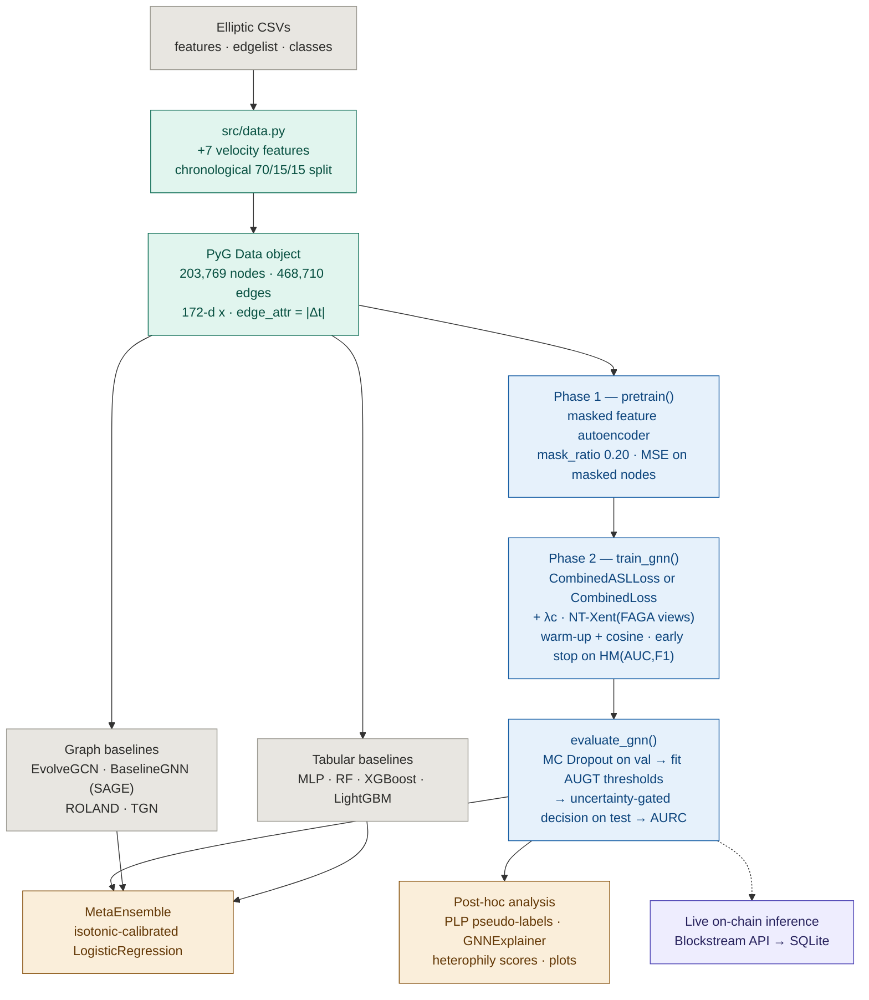
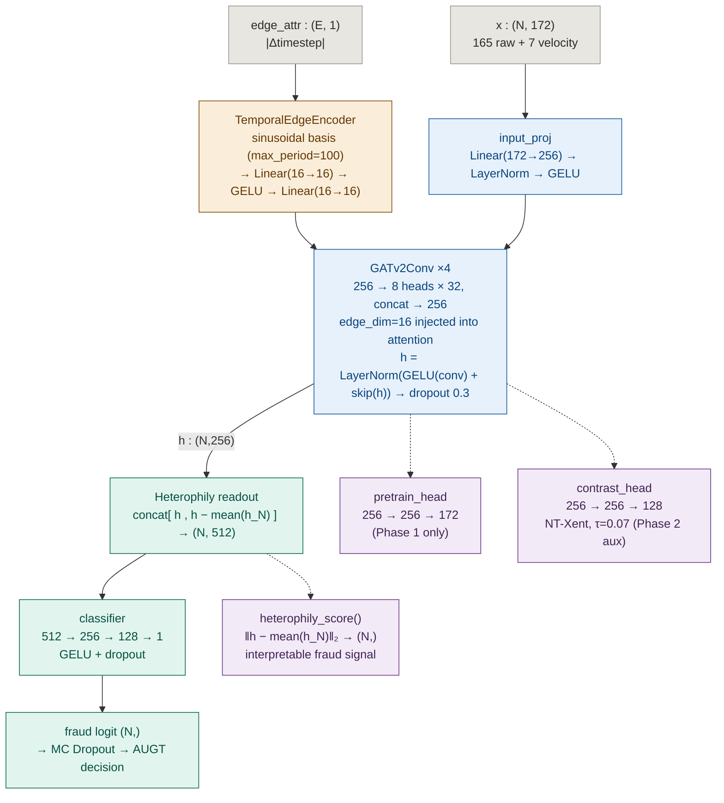

<div align="center">

[](https://github.com/ria0304/Bitcoin-Transaction-Fraud-Detection-)


# ElliGAT — Bitcoin Transaction Fraud Detection

**Load it. Train it. Explain it. Flag the illicit transactions hiding in a Bitcoin graph.**

ElliGAT turns the Elliptic Bitcoin transaction graph into fraud predictions, uncertainty-aware decisions, and per-node explanations — using a heterophily-aware GATv2 network, a tabular baseline suite, a stacked MetaEnsemble, and a live on-chain inference demo against real Bitcoin blocks.

</div>

---

## The Problem

Cryptocurrency networks have no central authority, which makes them attractive for money laundering, ransomware payments, and other illicit activity. Detecting it is hard for three reasons:

**1. The graph is heterophilous.** Fraudsters deliberately route funds through legitimate wallets (mixing, layering), so an illicit node is usually surrounded by licit neighbours. Standard GNNs average neighbour messages and wash out exactly the signal that distinguishes fraud.

**2. The data is severely imbalanced.** Only ~9.76% of labelled transactions are illicit. A model can post a strong AUC and still miss most of the fraud that matters.

**3. The graph evolves over time.** The dataset spans 49 timesteps. A model that ignores temporal structure treats edges from different periods as equivalent and loses transaction velocity and sequence information.

---

## The Solution

ElliGAT is built around those three properties instead of treating them as noise.

- **Heterophily-aware readout** — appends the difference between a node and its neighbourhood mean to its embedding: `[h_i ∥ h_i − μ(h_Nj)]`
- **Imbalance-robust training** — Focal Loss (α=0.80, γ=2.5) or Asymmetric Loss; checkpoints are selected on the harmonic mean of AUC and F1, not AUC alone
- **Temporal edge encoding** — every edge carries a 16-d encoding of `|Δtimestep|` that GATv2 attention can read
- **Two-phase training** — masked-feature autoencoder pre-training (mask ratio 0.20), then supervised fine-tuning
- **MetaEnsemble** — an isotonic-calibrated logistic regression stacks the GNNs with XGBoost, LightGBM, RandomForest, and MLP

The system outputs:

- A **fraud probability per transaction**
- **Uncertainty-gated decisions** (MC Dropout + adaptive two-threshold abstention)
- **Per-node explanations** via GNNExplainer, plus an interpretable **heterophily score**
- **Pseudo-labels** for the ~77% of nodes that have no ground truth
- A **multi-seed results table** with mean ± std and Wilcoxon tests
- A **live on-chain demo** that scores real transactions fetched from the latest Bitcoin block

---

## Core Pipeline

```
Elliptic CSVs (features · classes · edgelist)
        ↓
Feature engineering — +7 velocity features → 172-d per node
        ↓
Chronological 70 / 15 / 15 split  →  PyG graph (203,769 nodes · 468,710 edges)
        ↓
Phase 1 — self-supervised pre-training (masked feature autoencoder)
        ↓
Phase 2 — fine-tuning (Focal / Asymmetric loss + FAGA contrastive term)
        ↓
Evaluation — MC Dropout → AUGT thresholds → uncertainty-gated test decision
        ↓
Baselines — GNNs (EvolveGCN · SAGE · ROLAND · TGN) + tabular (MLP · RF · XGB · LGBM)
        ↓
MetaEnsemble stacker  →  multi-seed aggregate + Wilcoxon tests
        ↓
Post-hoc — PLP pseudo-labels · GNNExplainer · heterophily scores · plots
        ↓
(optional) Live on-chain inference → SQLite history + prediction log
```

---

## Features

| Feature | Status |
|---|---|
| Elliptic loading, velocity features, chronological split | ✅ |
| ElliGAT — 4-layer GATv2, temporal edges, heterophily readout | ✅ verified (5 seeds) |
| Self-supervised pre-training | ✅ verified (5 seeds) |
| Focal Loss | ✅ verified (5 seeds) |
| Tabular baselines (MLP · RF · XGBoost · LightGBM) | ✅ verified (5 seeds, two separate runs) |
| MetaEnsemble stacker | ✅ verified (5 seeds) |
| BaselineGNN (GraphSAGE ablation) | ✅ verified (5 seeds) |
| EvolveGCN | 🔶 disabled in the verified run — paper numbers cited |
| ROLAND · TGN baselines | 🔶 implemented, no results row |
| Sinusoidal temporal edge encoder (current default) | 🔶 implemented, not benchmarked |
| Asymmetric Loss (current default) | 🔶 implemented, ElliGAT not benchmarked with it |
| FAGA · AUGT · PLP · GNNExplainer | 🔶 implemented, no completed real-data run |
| Live on-chain inference (Blockstream API) | ✅ feasibility demo |
| SQLite history + prediction log | ✅ |
| GitHub Actions pipeline (full / stepwise / dataset download) | ✅ |

✅ = backed by a real run in this repo · 🔶 = code exists, no benchmark yet

---

## Results

Averaged over **5 seeds** (42, 123, 2024, 17, 99), chronological 70/15/15 split, GPU run, `LOSS_NAME=focal` with the legacy `mlp` edge encoder. Source: `outputs/run_log_final.txt`. Std is population std across seeds.

| Model | ROC-AUC | F1 | MCC |
|---|---|---|---|
| MLP | 0.9673 ± 0.0068 | 0.8206 ± 0.0047 | 0.8167 ± 0.0062 |
| RandomForest | 0.9894 ± 0.0007 | 0.8441 ± 0.0021 | 0.8405 ± 0.0031 |
| XGBoost | 0.9907 ± 0.0010 | 0.8508 ± 0.0147 | 0.8419 ± 0.0180 |
| **LightGBM** | **0.9917 ± 0.0001** | **0.8770 ± 0.0038** | **0.8716 ± 0.0049** |
| EvolveGCN (cited, Pareja et al. 2020) | ~0.940 | ~0.720 | — |
| BaselineGNN (GraphSAGE) | 0.9250 ± 0.0039 | 0.7738 ± 0.0060 | 0.7672 ± 0.0070 |
| ElliGAT | 0.9468 ± 0.0054 | 0.7925 ± 0.0104 | 0.7837 ± 0.0108 |
| MetaEnsemble | 0.9870 ± 0.0027 | 0.8629 ± 0.0039 | 0.8570 ± 0.0037 |

> ElliGAT precision 0.8976 ± 0.0112 · recall 0.7096 ± 0.0131 · balanced accuracy 0.8514 ± 0.0066
> Graph: 203,769 nodes · 468,710 undirected edges · 172 features per node

### How to read this table honestly

- **LightGBM is the strongest model here.** Tabular boosting beats ElliGAT by roughly 0.08 F1 and beats the MetaEnsemble on every metric. On Elliptic, the 166 aggregated features already encode much of the neighbourhood information, so a graph model has to earn its keep elsewhere — uncertainty, explainability, and graph-native signals.
- **ElliGAT beats the GNN baselines, not the tabular ones.** Over BaselineGNN it gains about +1.9 pts F1 and +2.2 pts AUC.
- **The EvolveGCN comparison is not like-for-like.** The EvolveGCN figures come from a different paper and protocol, so the margins over it (ElliGAT ≈ +7.3 pts F1, MetaEnsemble ≈ +14.3 pts F1) are indicative only. EvolveGCN was disabled in the verified run.
- **Current defaults differ from this table.** `configs/config.py` now ships `LOSS_NAME=asymmetric` and `EDGE_ENCODING=sinusoidal`. To reproduce the table: `LOSS_NAME=focal EDGE_ENCODING=mlp`.

### CPU CI run (`result/`)

A separate GitHub Actions run (`result/run-7-full`, tabular + MetaEnsemble job only, `asymmetric` loss, `sinusoidal` encoder, hidden dim 128, 5 seeds) is aggregated in `result/latest/`. It reproduces the tabular numbers closely (e.g. LightGBM 0.9915 ± 0.0006 AUC, 0.8752 ± 0.0039 F1). It contains **no ElliGAT row**, so its Wilcoxon comparison is skipped.

---

## Architecture

### System pipeline



### ElliGAT model internals



### Layer reference

| Stage | Component | Shape / config |
|---|---|---|
| Input | Node features | `(N, 172)` — 165 raw + 7 velocity |
| Input | Edge features | `(E, 1)` — `\|Δtimestep\|` |
| Edge encoder | `TemporalEdgeEncoder` | **sinusoidal** (default) or **mlp** (legacy, reproduces the Results table) |
| Encoder | `input_proj` | `Linear(172→256) → LayerNorm → GELU` |
| Encoder | `GATv2Conv × 4` | `256 → 8 heads × 32 (concat)`, `edge_dim=16`, `dropout=0.3`, residual + `LayerNorm` |
| Readout | Heterophily concat | `(N, 512)` = `[h ∥ h − μ(h_N)]` |
| Head | `classifier` | `512 → 256 → 128 → 1` |
| Aux head | `pretrain_head` | `256 → 256 → 172` (Phase 1 reconstruction) |
| Aux head | `contrast_head` | `256 → 256 → 128` (NT-Xent, τ = 0.07) |
| Signal | `heterophily_score()` | `(N,)` L2 norm of the difference term |

---

## Training Protocol

```
Phase 1 — pretrain()                     src/trainer.py
  • Mask 20% of node features, encode, reconstruct via pretrain_head
  • MSE on masked nodes only · warm-up + cosine LR

Phase 2 — train_gnn()                    src/trainer.py
  • LOSS_NAME=asymmetric (default) → CombinedASLLoss
    LOSS_NAME=focal                → CombinedLoss   ← verified Results table
  • + λc · NT-Xent over two FAGA views (src/augmentation.py)
  • Early stopping on HM(AUC, F1), patience 30, max 300 epochs

Evaluation — evaluate_gnn()              src/trainer.py
  • MC Dropout on val → per-node mean probability + uncertainty
  • fit AUGT thresholds on val → uncertainty-gated decision on test
  • Reports AURC / coverage; falls back to a grid-searched threshold
    if validation contains only one class

Phase 3 (post-hoc) — run_plp()           src/pseudo_label.py
  • MC Dropout over all nodes → pseudo-label confident unlabelled nodes
  • Re-train with a down-weighted pseudo-label loss
```

### Temporal edge encoding

| Mode | Encoding | Use |
|---|---|---|
| `sinusoidal` *(default)* | Fixed sin/cos basis on `\|Δt\|`, then a learned 2-layer projection | Multi-scale view of the temporal gap — fast channels separate Δ=0 from Δ=1, slow channels separate short from long hops |
| `mlp` *(legacy)* | `Linear(1→16) → GELU → Linear(16→16)` | Reproduces the verified 5-seed Results table |

`max_period` defaults to **100**, not the NLP-standard 10000. Elliptic deltas lie in `[0, 48]`; at 10000 the highest channels vary by less than `1e-3` across that range and carry no signal.

### MetaEnsemble

```
Base models : ElliGAT · EvolveGCN · BaselineGNN · ROLAND · TGN · MLP · RF · XGBoost · LightGBM
Stacker     : isotonic-calibrated LogisticRegression (5-fold CV) over base probabilities
```

---

## Novel Extensions

Four modules and an alternate loss sit on top of the verified baseline. All are implemented and exercised on synthetic data; **none has a completed run on the real dataset in this repo**. Treat this section as implemented, not benchmarked.

| Module | File | What it does |
|---|---|---|
| **FAGA** — Fraud-Aware Graph Augmentation | `src/augmentation.py` | Contrastive augmentation that avoids destroying minority-class signal, unlike random edge-drop / feature-mask on a heterophilous graph |
| **AUGT** — Adaptive Uncertainty-Gated Threshold | `src/uncertainty.py` | Per-node two-threshold abstention (`tau_low`, `tau_high`) driven by MC-Dropout uncertainty, replacing one grid-searched threshold |
| **PLP** — Pseudo-Label Propagation | `src/pseudo_label.py` | Pseudo-labels the 77.1% of nodes with no ground truth using MC-Dropout confidence, then retrains with a down-weighted loss |
| **GNNExplainer attribution** | `src/explain.py` | Attributes predictions to subgraphs and features; reports Fidelity+ / Fidelity− |
| **ASL** — Asymmetric Loss | `src/losses.py` | Alternate to Focal Loss (`gamma_pos=0.0`, `gamma_neg=4.0`, `clip=0.05`); current config default |

```bash
python run_faga_ablation.py         # edge-drop / feature-mask ablations
python run_plp_ablation.py          # confidence threshold / lambda_pl / MC-sample ablations
python run_clean_reproduction.py    # full pipeline: FAGA + AUGT + PLP + GNNExplainer
```

The ablation scripts have not produced saved results yet. `outputs/run_log.txt` records a run that loaded the real graph correctly and stopped after Phase 1.

---

## Key Design Choices vs Baseline

| Feature | BaselineGNN | ElliGAT |
|---|---|---|
| Architecture | 2 × `SAGEConv` (GraphSAGE) | 4 × `GATv2Conv` with residuals + LayerNorm |
| Edge features | Not used | Temporal Δtimestep encoding |
| Hidden dim | 128 | 256 (config default) |
| Attention heads | — | 8 (config default) |
| Heterophily readout | None | `[h ∥ h − μ(h_N)]` |
| Auxiliary heads | None | Pre-training reconstruction + contrastive projection |

---

## Dataset

| Statistic | Value |
|---|---|
| Transactions (nodes) | 203,769 |
| Payment flows (directed edges) | 234,355 → 468,710 undirected |
| Features per node | 172 (165 raw + 7 velocity) |
| Labelled transactions | 46,564 (~22.9%) |
| Fraud class ratio | 9.76% overall · 11.51% in the labelled train split |
| Train / Val / Test split | 32,594 / 6,984 / 6,986 (chronological) |
| Timesteps | 49 (~2 weeks each, ~3 years) |

### Blockchain data provenance

ElliGAT trains on the **Elliptic dataset**, a graph *derived* from the real Bitcoin blockchain by Weber et al. (2019) — not on raw chain data.

1. **Blocks → Transactions.** Each block contains the transactions confirmed at that point in time.
2. **Transactions → UTXO graph.** Every transaction consumes prior unspent outputs and creates new ones; following those links gives a directed graph of payment flows.
3. **UTXO graph → node/edge graph.** Elliptic samples transactions as nodes and payment flows as edges, with 166 anonymised features per node, grouped into 49 timesteps.
4. **Labels via forensic clustering.** Roughly 22.9% of nodes are labelled licit or illicit via address-clustering heuristics tied to known real-world entities.

Heterophily, imbalance, and temporal drift are consequences of this pipeline, not artefacts of the file format.

---

## Live On-Chain Inference

`src/onchain.py` fetches the latest confirmed Bitcoin block from Blockstream's Esplora API (no API key), rebuilds a payment-flow graph, and runs a trained ElliGAT checkpoint on it.

```bash
pip install requests
python -m src.onchain --num-tx 200 --top-k 15 --checkpoint outputs/best_model.pt
```

1. Fetches the latest block and up to `--num-tx` transactions from `blockstream.info/api`.
2. Builds edges the same way `src/data.py` does — `A → B` exists if `B` spends an output of `A`.
3. Computes the 7 velocity features for real.
4. Loads `outputs/best_model.pt` and prints the highest-risk transactions.

**This is a feasibility demo, not a fraud detector.** The other 166 Elliptic features are an undocumented, proprietary transformation that cannot be rebuilt from a public API, so they are zero-imputed. Only 7 of 172 input dimensions carry real information on live data. Do not compare its output to the benchmark table.

### Persistence (SQLite)

`src/database.py` backs the live path with `outputs/onchain_history.db`:

- **Transaction history** — fetched transactions upsert into a `transactions` table, so rolling-window features (`tx_count_1h`, `tx_count_24h`, `amount_sum_1h`, `amount_std_1h`) accumulate across repeated runs.
- **Prediction log** — every run records `(txid, fraud_probability, checkpoint_path, timestamp)` to a `predictions` table.

```bash
python -m src.onchain --num-tx 200 --checkpoint outputs/best_model.pt --db-path outputs/onchain_history.db
```

SQLite is a deliberate choice: this is a local, single-user research pipeline, not a multi-writer service.

---

## Tech Stack

| Category | Tools |
|---|---|
| Deep learning | PyTorch |
| GNN layers | GATv2Conv, SAGEConv (PyTorch Geometric) |
| Tabular models | XGBoost, LightGBM, RandomForest, scikit-learn MLP |
| Meta-learner | scikit-learn LogisticRegression (isotonic calibration, 5-fold CV) |
| Uncertainty | Monte Carlo Dropout |
| Explainability | GNNExplainer |
| Data | Pandas, NumPy, KaggleHub |
| Statistics | SciPy (Wilcoxon signed-rank) |
| Visualisation | Matplotlib |
| Live data | Blockstream Esplora API, `requests` |
| Storage | SQLite |
| CI | GitHub Actions (CPU runners, per-seed and per-method jobs) |
| Notebooks | Google Colab (T4 GPU) |

---

## Project Structure

```
Bitcoin-Transaction-Fraud-Detection-/
│
├── main.py                           # Full pipeline entry point
├── run_clean_reproduction.py         # FAGA + AUGT + PLP + GNNExplainer run
├── run_faga_ablation.py              # FAGA component ablations
├── run_plp_ablation.py               # PLP component ablations
├── requirements.txt
├── .env.example                      # Environment variable template
│
├── configs/
│   └── config.py                     # Hyperparameters, paths, LOSS_NAME / EDGE_ENCODING switches
│
├── src/
│   ├── data.py                       # Loading, velocity features, graph builder
│   ├── models.py                     # ElliGAT, EvolveGCN, BaselineGNN
│   ├── baselines.py                  # Tabular models, ROLAND/TGN, MetaEnsemble stacker
│   ├── losses.py                     # FocalLoss, AsymmetricLoss, combined losses
│   ├── trainer.py                    # Pre-training, fine-tuning, evaluation, MC Dropout
│   ├── augmentation.py               # FAGA — fraud-aware augmentation
│   ├── uncertainty.py                # AUGT — uncertainty-gated thresholds
│   ├── pseudo_label.py               # PLP — pseudo-label propagation
│   ├── explain.py                    # GNNExplainer attribution
│   ├── onchain.py                    # Live Bitcoin inference (Blockstream API)
│   ├── database.py                   # SQLite history + prediction log
│   ├── logger.py                     # Console + file logger
│   └── visualize.py                  # Results figures
│
├── scripts/
│   ├── merge_methods.py              # Merge per-method metrics into one file per seed
│   └── aggregate_results.py          # Mean ± std table, per_seed.csv, Wilcoxon tests
│
├── .github/workflows/
│   ├── pipeline.yml                  # Full pipeline, one parallel job per seed
│   ├── elligat-stepwise.yml          # One method per job (avoids OOM kills)
│   ├── download-elliptic.yml         # Dataset download via Kaggle CLI
│   └── elligat.yml                   # Runner preflight (CPU / memory / disk)
│
├── outputs/                          # Run logs and summaries
│   └── run_log_final.txt             # GPU run behind the Results table
├── result/
│   ├── latest/                       # Aggregate of the newest CI run
│   └── run-7-full/                   # Per-method and per-seed CI artefacts
│
├── ElliGAT_Colab_Full_fixed (2).ipynb
├── ElliGAT_Journal_Corrected_Colab (2).ipynb
├── results_all.png · results_comparison.png · confusion_matrix_elligat.png
└── tech stack                        # Plain-text stack notes
```

---

## Run Locally

**Step 1 — Clone and install**

```bash
git clone https://github.com/ria0304/Bitcoin-Transaction-Fraud-Detection-.git
cd Bitcoin-Transaction-Fraud-Detection-
pip install -r requirements.txt
```

`torch_scatter`, `torch_sparse`, and `torch_cluster` are intentionally not required.

**Step 2 — Set up the environment**

```bash
cp .env.example .env
```

Point `BITCOIN_DATA_PATH` at a folder containing `elliptic_txs_features.csv`, `elliptic_txs_classes.csv`, and `elliptic_txs_edgelist.csv`:

```env
BITCOIN_DATA_PATH=/path/to/elliptic-data-set
```

> **No dataset?** Leave `BITCOIN_DATA_PATH` empty and the pipeline tries to download it via [KaggleHub](https://github.com/Kaggle/kagglehub). That needs `KAGGLE_USERNAME` and `KAGGLE_KEY` in `.env`, or `~/.kaggle/kaggle.json`.

**Step 3 — Run the pipeline**

```bash
python main.py
```

Logs go to `outputs/run_log.txt`. Mean ± std across seeds prints to stdout on completion.

**Reproduce the verified Results table**

```bash
LOSS_NAME=focal EDGE_ENCODING=mlp python main.py
```

**Run only some methods**

```bash
METHODS=Tabular SEEDS=42 python main.py            # tabular baselines, one seed
METHODS=ElliGAT,Tabular,Meta python main.py        # ElliGAT + baselines + stacker
```

Valid methods: `ElliGAT, EvolveGCN, BaselineGNN, ROLAND, TGN, Tabular, Meta`. `Meta` needs ElliGAT in the same run, or `ELLIGAT_PROBS_DIR` pointing at a folder of `elligat_probs_seed<N>.npz` files.

### Google Colab (GPU)

The full 5-seed run took roughly **46 minutes on a T4**.

```python
!git clone https://github.com/ria0304/Bitcoin-Transaction-Fraud-Detection- /content/elligat
%cd /content/elligat
!pip install -r requirements.txt
!python -u main.py 2>&1 | tee outputs/run_log_final.txt
```

Set Runtime → T4 GPU first. Ready-made notebooks are included in the repo root.

### GitHub Actions

All workflows are manual (`workflow_dispatch`).

| Workflow | Purpose |
|---|---|
| `pipeline.yml` | Full pipeline on CPU runners — `mode=smoke` (1 seed, tiny epochs) to check every stage, `mode=full` for a real run, one parallel job per seed |
| `elligat-stepwise.yml` | Same pipeline, one method per job, so a heavy method cannot OOM-kill the others; `methods` input selects `all`, `elligat-only`, `baselines-only`, or `tabmeta-only` |
| `download-elliptic.yml` | Downloads and verifies the three Elliptic CSVs (needs a `KAGGLE_API_TOKEN` secret) |
| `elligat.yml` | Prints runner CPU / memory / disk for sizing |

---

## Verify It's Working

```bash
# 1. Quick sanity check — one seed, tabular only, no GPU needed
METHODS=Tabular SEEDS=42 python main.py
```

You should see the dataset load line, then the split:

```
[Elliptic] 203,769 total | 46,564 labelled | Fraud: 0.0976
Train: 32,594  Val: 6,984  Test: 6,986
Nodes: 203,769  Edges: 468,710  Features/node: 172
```

```bash
# 2. Aggregate per-seed CI results into one mean ± std table
python scripts/aggregate_results.py <results_dir> <out_dir>
```

There is no automated test suite in this repository yet.

---

## Common Issues

| Problem | Fix |
|---|---|
| Dataset not found / pipeline blocked at Step 1 | Set `BITCOIN_DATA_PATH`, or provide Kaggle credentials for auto-download |
| `configs/config.py` points at a Windows path | The fallback default is the author's local path — always set `BITCOIN_DATA_PATH` (and `ELLIPTIC_CACHE_PATH` if needed) |
| `xgboost` / `lightgbm` import errors | `pip install -r requirements.txt` again; these are listed as required |
| Run killed with exit code 143 / out of memory | Lower `HIDDEN_DIM` (e.g. 128 or 64); use the stepwise workflow on CI |
| ElliGAT is much slower than the tabular models | Expected on CPU — use a GPU or Colab; set `EXPLAIN_NODES` / `EXPLAIN_EPOCHS` lower for GNNExplainer |
| Numbers don't match the Results table | You are on the new defaults; set `LOSS_NAME=focal EDGE_ENCODING=mlp` |
| `result/latest` shows no ElliGAT row | That CI run was tabular + MetaEnsemble only |
| Live inference outputs look random | Expected — 166 of 172 features are zero-imputed on live data |

---

## Deployment

Local and CI only. There is no Dockerfile, no hosted service, and no served API. `outputs/onchain_history.db` is created on first live-inference run.

---

## Environment Variables

| Variable | Required | Description |
|---|---|---|
| `BITCOIN_DATA_PATH` | ✅ unless using Kaggle | Folder containing the three Elliptic CSVs |
| `KAGGLE_USERNAME` / `KAGGLE_KEY` | No | Needed only for KaggleHub auto-download |
| `ELLIPTIC_CACHE_PATH` / `ELLIPTIC_CACHE` | No | Location of the KaggleHub cache |
| `OUTPUT_DIR` | No | Where weights, metrics, and plots go (default `outputs`) |
| `METHODS` | No | Comma list: `ElliGAT, EvolveGCN, BaselineGNN, ROLAND, TGN, Tabular, Meta` |
| `ELLIGAT_PROBS_DIR` | No | Folder of `elligat_probs_seed<N>.npz`, lets `Meta` run without ElliGAT |
| `SEEDS` | No | Comma-separated seeds (default `42,123,2024,17,99`) |
| `LOSS_NAME` | No | `asymmetric` (default) or `focal` |
| `ASL_GAMMA_POS` / `ASL_GAMMA_NEG` / `ASL_CLIP` | No | Asymmetric Loss parameters (defaults `0.0` / `4.0` / `0.05`) |
| `EDGE_ENCODING` | No | `sinusoidal` (default) or `mlp` |
| `EDGE_MAX_PERIOD` | No | Sinusoidal max wavelength (default `100`) |
| `HIDDEN_DIM` | No | Hidden size (default `256`) |
| `NUM_GAT_LAYERS` / `NUM_HEADS` / `DROPOUT` | No | Defaults `4` / `8` / `0.3` |
| `LEARNING_RATE` / `WEIGHT_DECAY` | No | Defaults `5e-4` / `1e-4` |
| `EPOCHS` / `PATIENCE` | No | Defaults `300` / `30` |
| `PRETRAIN_EPOCHS` | No | Phase 1 epochs (default `50`) |
| `MC_SAMPLES` | No | MC Dropout passes (default `30`) |
| `PLP_EPOCHS` | No | Pseudo-label retraining epochs (default `50`) |
| `EXPLAIN_NODES` / `EXPLAIN_EPOCHS` | No | GNNExplainer budget (defaults `30` / `150`) |
| `LOG_LEVEL` | No | Logging level (default `INFO`) |

---

## Entry Points

| Command | Description |
|---|---|
| `python main.py` | Full pipeline: all methods, multi-seed aggregate, PLP, GNNExplainer, plots |
| `python run_clean_reproduction.py` | Journal pipeline: FAGA + AUGT + PLP + GNNExplainer |
| `python run_faga_ablation.py` | FAGA ablations |
| `python run_plp_ablation.py` | PLP ablations |
| `python -m src.onchain ...` | Live Bitcoin inference with SQLite logging |
| `python scripts/merge_methods.py <in> <out>` | Merge per-method CI metrics into one file per seed |
| `python scripts/aggregate_results.py <results_dir> <out_dir>` | Write `metrics_aggregate.json`, `per_seed.csv`, `summary.md`; Wilcoxon tests need SciPy |

---

## Known Limitations

- **Tabular boosting beats the graph model.** LightGBM outscores ElliGAT and the MetaEnsemble on F1, MCC, and AUC in the verified run. The MetaEnsemble does not beat its best base model.
- **The EvolveGCN margins are cross-paper.** They compare against published numbers under a different protocol and are not a controlled result.
- **The novel extensions are unbenchmarked.** FAGA, AUGT, PLP, GNNExplainer, ASL, and the sinusoidal encoder have no completed real-data results.
- **The shipped defaults do not reproduce the Results table.** You must set `LOSS_NAME=focal EDGE_ENCODING=mlp`.
- **ROLAND and TGN have no results row.** EvolveGCN was disabled in the verified run, and the in-repo `EvolveGCN_O` is built from `GCNConv` layers — treat it as a simplified stand-in, not a reproduction of the paper.
- **Live inference uses 7 of 172 real features.** The remaining 166 are zero-imputed.
- **The Elliptic dataset is a static, anonymised snapshot.** The labelled 22.9% is not a random sample, and results may not transfer to current chain behaviour.
- **The heterophily readout is a symmetric neighbourhood mean.** On the undirected graph it is not a directional predecessor mean, despite what a docstring may suggest.
- **A hard-coded Windows path remains in `configs/config.py`** as a fallback default.
- **No automated tests, no Dockerfile.** Everything is run and verified by hand or through CI.
- **Local single-user SQLite only.** Not built for concurrent writers.

---

## Future Scope

| Feature | Why |
|---|---|
| Complete real-data runs for FAGA / AUGT / PLP / GNNExplainer | Turn "implemented" into "benchmarked" |
| Benchmark `sinusoidal` + `asymmetric` against the focal / `mlp` baseline | Know whether the new defaults actually help |
| Stack from LightGBM-first features or add graph features to the boosters | Close the gap between graph and tabular models |
| ROLAND / TGN results rows | Complete the temporal GNN comparison |
| Temporal-ordered evaluation on the later Elliptic++ data | Test transfer beyond the original snapshot |
| Real feature reconstruction for live transactions | Make on-chain inference a meaningful score |
| Unit tests + a pinned CI smoke job | Catch regressions without a full run |
| Dockerfile + Postgres | Reproducible, multi-writer deployment |

---

## Citation

```bibtex
@inproceedings{weber2019anti,
  title     = {Anti-Money Laundering in Bitcoin: Experimenting with
               Graph Convolutional Networks for Financial Forensics},
  author    = {Weber, Mark and Domeniconi, Giacomo and Chen, Jie and
               Weidele, Daniel Karl I. and Bellei, Claudio and
               Robinson, Tom and Leiserson, Charles E.},
  booktitle = {KDD Workshop on Anomaly Detection in Finance},
  year      = {2019}
}
```

```bibtex
@inproceedings{pareja2020evolvegcn,
  title     = {EvolveGCN: Evolving Graph Convolutional Networks for Dynamic Graphs},
  author    = {Pareja, Aldo and Domeniconi, Giacomo and Chen, Jie and
               Ma, Tengfei and Suzumura, Toyotaro and Kanezashi, Hiroki and
               Kaler, Tim and Schardl, Tao and Leiserson, Charles},
  booktitle = {AAAI},
  year      = {2020}
}
```
